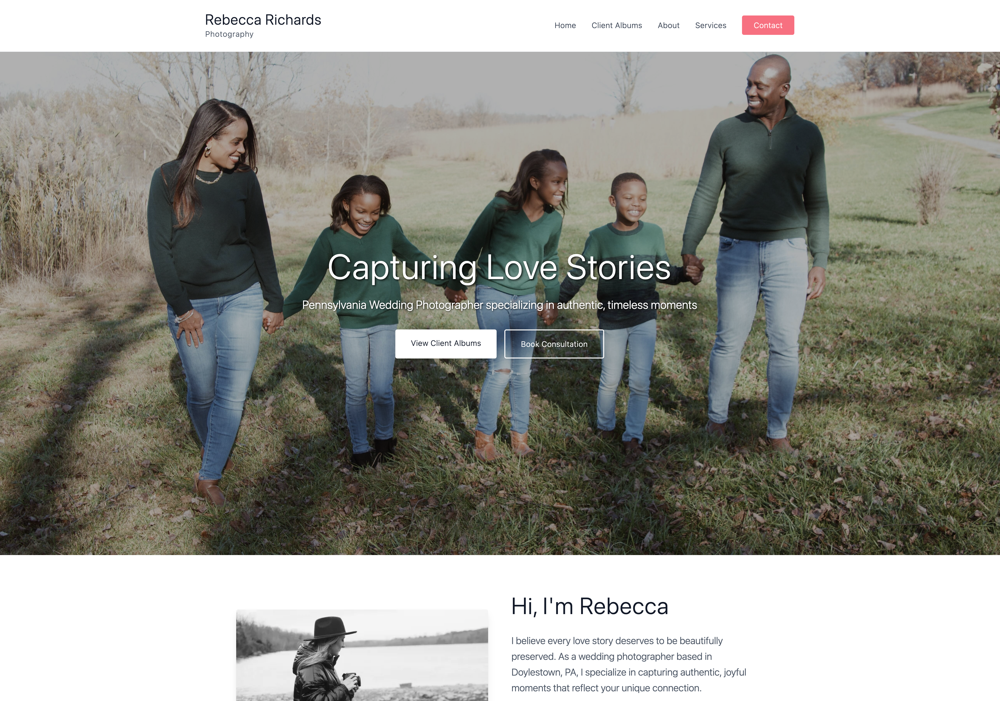

# 📸 Rebecca Richards Photography

> A modern, elegant photography portfolio website built with Astro, React, Tailwind CSS, and Sanity CMS

[](https://astro.build)
[](https://tailwindcss.com)
[](https://opensource.org/licenses/MIT)

## ✨ Overview

A complete redesign of Rebecca Richards' professional wedding photography website. This modern portfolio showcases Rebecca's stunning photography work with a clean, professional presentation, dynamic content management via Sanity CMS, and smooth animations powered by Framer Motion.

### 🎯 Key Features

- **Dynamic Content Management**: Sanity CMS integration for easy album and image management
- **Smooth Animations**: Framer Motion-powered page transitions and scroll animations
- **Mobile-First Responsive**: Beautiful experience on all devices
- **Fast Performance**: Astro's static generation with optimized images
- **Client Album Galleries**: Interactive lightbox galleries for client work
- **Professional Branding**: Focused messaging and consistent visual identity
- **SEO Optimized**: Proper meta tags and semantic HTML structure

## 🚀 Demo

**Live Site**: [https://rebecca-richards-photography.vercel.app](https://rebecca-richards-photography.vercel.app).

### 📱 Screenshots

| Desktop                                        | Mobile                                       |
| ---------------------------------------------- | -------------------------------------------- |
|  |  |

## 🋭 Tech Stack

- **Framework**: [Astro 5.x](https://astro.build) - Static site generator with zero JS by default
- **Frontend**: [React 19](https://react.dev) - For interactive components and animations
- **CMS**: [Sanity](https://sanity.io) - Headless CMS for content management
- **Styling**: [Tailwind CSS 4.x](https://tailwindcss.com) - Utility-first CSS framework
- **Animations**: [Framer Motion](https://framer.com/motion) - Production-ready motion library
- **Icons**: [Lucide](https://lucide.dev) - Beautiful, customizable SVG icons
- **OG Images**: [@vercel/og](https://vercel.com/docs/functions/edge-functions/og-image-generation) - Dynamic OG image generation
- **Analytics**: Built-in analytics integration with privacy focus
- **SEO**: Structured data (JSON-LD) and comprehensive meta tags
- **Image Processing**: [Sharp](https://sharp.pixelplumbing.com/) - High-performance image processing
- **Data Scraping**: Python-based scraper with Selenium WebDriver
- **Code Quality**: ESLint + Prettier with TypeScript support
- **Deployment**: Ready for Vercel, Netlify, or GitHub Pages

## 🏩 Project Structure

```
rebecca-richards-photography/
├── client-album-scraper/          # Python scraper for album data
│   ├── src/
│   │   ├── core/                  # Configuration and logging
│   │   ├── metadata/              # Album name and metadata extraction
│   │   ├── processing/            # Scraping and processing logic
│   │   ├── utils/                 # Common utilities
│   │   └── web/                   # WebDriver and browser interactions
│   ├── requirements.txt
│   ├── scraper.py
│   └── setup.sh
├── docs/
│   ├── OG-IMAGES.md              # OG image generation documentation
│   └── SEO-IMPLEMENTATION.md     # SEO features documentation
├── public/
│   ├── icons/                    # Favicons and app icons
│   ├── images/                   # Static images
│   ├── meta/                     # Meta images and assets
│   └── og/                       # Generated OG images
├── sanity-studio/                # Sanity CMS configuration
├── scripts/
│   ├── generate-og-images.js     # OG image generation script
│   ├── image-to-datauri.js       # Image to data URI converter
│   ├── migrate-to-sanity.js      # Data migration script
│   └── test-sanity-connection.js # Sanity connection testing
├── src/
│   ├── components/
│   │   ├── AlbumCard.tsx         # Album display component
│   │   ├── AnimatedContainer.tsx # Animation wrapper
│   │   ├── Breadcrumbs.astro     # Navigation breadcrumbs
│   │   ├── Footer.astro          # Site footer
│   │   ├── Header.astro          # Site header
│   │   ├── PageTransition.tsx    # Page transition animations
│   │   ├── ScrollAnimation.tsx   # Scroll-based animations
│   │   └── StaggeredGrid.tsx     # Staggered grid layout
│   ├── layouts/
│   │   └── Layout.astro          # Main page layout
│   ├── lib/
│   │   ├── analytics.ts          # Analytics integration
│   │   ├── og-images.tsx         # OG image generation
│   │   ├── og-utils.ts           # OG image utilities
│   │   ├── sanity.ts             # Sanity client configuration
│   │   └── structured-data.ts    # JSON-LD structured data
│   ├── pages/
│   │   ├── about.astro           # About page
│   │   ├── client-albums.astro   # Client albums listing
│   │   ├── contact.astro         # Contact page
│   │   ├── index.astro           # Homepage
│   │   ├── og-preview.astro      # OG image preview page
│   │   ├── services.astro        # Services page
│   │   ├── albums/
│   │   │   └── [slug].astro      # Dynamic album pages
│   │   └── api/
│   │       └── og.ts             # OG image API endpoint
│   └── styles/
│       └── global.css            # Global styles
├── .env.example                  # Environment variables template
├── astro.config.mjs              # Astro configuration
├── eslint.config.js              # ESLint configuration
├── package.json                  # Dependencies and scripts
└── tsconfig.json                 # TypeScript configuration
```

## 🚦 Getting Started

### Prerequisites

- Node.js 18+
- npm or yarn
- ImageMagick (for image optimization)

### Installation

1. **Clone the repository**

   ```bash
   git clone https://github.com/nicholasadamou/rebecca-richards-photography.git
   cd rebecca-richards-photography
   ```

2. **Install dependencies**

   ```bash
   npm install
   ```

3. **Start development server**

   ```bash
   npm run dev
   ```

4. **Open in browser**
   Navigate to `http://localhost:4321`

### 🔧 Available Scripts

- `npm run dev` - Start development server
- `npm run build` - Build for production (includes OG image generation)
- `npm run preview` - Preview production build
- `npm run astro` - Run Astro CLI commands
- `npm run og:generate` - Generate OG images for all pages
- `npm run sanity:dev` - Start Sanity Studio development server
- `npm run sanity:build` - Build Sanity Studio
- `npm run sanity:deploy` - Deploy Sanity Studio
- `npm run lint` - Lint code with ESLint
- `npm run lint:fix` - Fix linting issues automatically
- `npm run format` - Format code with Prettier
- `npm run format:check` - Check code formatting
- `npm run test:sanity` - Test Sanity connection
- `npm run migrate:sanity` - Migrate data to Sanity

## 🍈 Features

### 📄 Pages

- **Homepage**: Hero section with recent work from Sanity CMS and services overview
- **Client Albums**: Dynamic album listing from Sanity CMS with cover images
- **Album Detail**: Individual album pages with interactive lightbox galleries
- **About**: Rebecca's story, background, and photography philosophy
- **Services**: Wedding packages, pricing, and booking information
- **Contact**: Professional contact form and business information

## 🔍 Client Album Scraper

The project includes a sophisticated Python-based web scraper designed to extract album data from the original photography website. This tool automates the process of migrating existing content to the new Sanity CMS.

### 🏠 Scraper Architecture

- **Modular Design**: Organized into separate modules for different responsibilities
- **Core**: Configuration management and logging system
- **Metadata**: Album name extraction and metadata processing
- **Processing**: Multi-threaded scraping and image processing
- **Web**: WebDriver management and browser automation
- **Utils**: Common utilities and helper functions

### 🚀 Usage

```bash
# Navigate to the scraper directory
cd client-album-scraper

# Setup virtual environment and dependencies
./setup.sh

# Run the scraper
python scraper.py
```

### ✨ Key Features

- **Concurrent Processing**: Multi-threaded download and processing for efficiency
- **Smart Metadata Extraction**: Automatic album name detection and cleanup
- **Image Optimization**: Automated image processing and compression
- **Error Handling**: Robust error handling with retry mechanisms
- **Progress Tracking**: Real-time progress monitoring and logging
- **Sanity Integration**: Direct integration with Sanity CMS for data migration

### 🎣 Key Components

- **Dynamic Content**: Albums and images loaded from Sanity CMS
- **Interactive Lightbox**: Full-screen image gallery with navigation and thumbnails
- **Smooth Animations**: Framer Motion page transitions and scroll animations
- **Responsive Navigation**: Mobile-friendly header with smooth animations
- **Image Optimization**: Compressed images served from Sanity CDN
- **TypeScript Support**: Type-safe React components and Astro integration
- **Advanced SEO**: Comprehensive meta tags, JSON-LD structured data, and OG images

### 🎨 Advanced Features

#### **OG Image Generation**
- **Dynamic Generation**: Automatically generates Open Graph images for all pages
- **Custom Templates**: Branded templates for different content types
- **Performance Optimized**: Pre-generated during build process
- **Vercel OG Integration**: Uses @vercel/og for efficient image creation

#### **SEO & Analytics**
- **Structured Data**: JSON-LD schema markup for search engines
- **Meta Tag Optimization**: Dynamic meta tags based on page content
- **Sitemap Generation**: Automatic XML sitemap creation
- **Analytics Ready**: Privacy-focused analytics integration

#### **Content Management**
- **Sanity CMS**: Full-featured headless CMS with real-time preview
- **Image CDN**: Sanity's optimized image delivery network
- **Content Migration**: Automated tools for importing existing content
- **Version Control**: Content versioning and revision history

#### **Development Experience**
- **TypeScript**: Full type safety across the application
- **Code Quality**: ESLint + Prettier with custom rules
- **Hot Reload**: Fast development with Astro's dev server
- **Build Optimization**: Optimized production builds with tree-shaking

### 🎪 Design Philosophy

- **Visual-First**: Large, high-quality images showcase Rebecca's work
- **Clean Typography**: Readable fonts with proper hierarchy
- **Subtle Animations**: Smooth hover effects and transitions
- **Professional Color Palette**: Soft rose and neutral tones
- **Accessibility**: Proper contrast ratios and semantic HTML

## 📸 Image Management

All images are authentic photographs from Rebecca's original website, properly optimized for web performance:

### Image Optimization Process

1. **Original Download**: Images pulled from current website
2. **Compression**: Using ImageMagick with 85% quality
3. **Sizing**: Appropriate dimensions for web display
4. **Format**: JPEG with optimized compression

Example optimization command:

```bash
magick input.jpg -quality 85 -strip output.jpg
```

## 📚 Documentation

Detailed documentation for specific features is available in the `docs/` directory:

- **[OG Images](docs/OG-IMAGES.md)**: Complete guide to Open Graph image generation
- **[SEO Implementation](docs/SEO-IMPLEMENTATION.md)**: In-depth SEO features and structured data

## Continuous integration

GitHub Actions builds the website and Open Graph images on standard GitHub-hosted
Ubuntu runners for pushes to `master` and pull requests. The workflow uses Node.js
24 and installs the committed npm lockfile with `npm ci`. Run `npm ci` and
`npm run build` locally to reproduce the build. Successful runs retain the built
website as a `website` artifact for seven days.

## 🚀 Deployment

### Vercel (Recommended)

1. Push to GitHub
2. Connect repository to Vercel
3. Deploy with zero configuration

### Netlify

1. Build command: `npm run build`
2. Publish directory: `dist`
3. Deploy

### Manual Build

```bash
npm run build
# Upload the 'dist' folder to your web server
```

## 🤝 Contributing

This is a client project, but suggestions and improvements are welcome:

1. Fork the repository
2. Create a feature branch (`git checkout -b feature/improvement`)
3. Commit changes (`git commit -am 'Add improvement'`)
4. Push to branch (`git push origin feature/improvement`)
5. Create a Pull Request

## 📝 License

This project is licensed under the MIT License - see the [LICENSE](LICENSE) file for details.

## 👥 Credits

- **Photography**: All images © Rebecca Richards Photography
- **Design & Development**: [Nicholas Adamou](https://github.com/nicholasadamou)
- **Original Concept**: Redesign of Rebecca's existing website

## 📞 Contact

For questions about this project:

- **Developer**: Nicholas Adamou
- **Client**: Rebecca Richards Photography
  - Email: rebeccarichardsevents@gmail.com
  - Phone: (267) 259-1036
  - Location: Doylestown, PA

---

<div align="center">
  <p>Built with ❤️ for Rebecca Richards Photography</p>
  <p>Capturing love stories, one pixel at a time</p>
</div>
