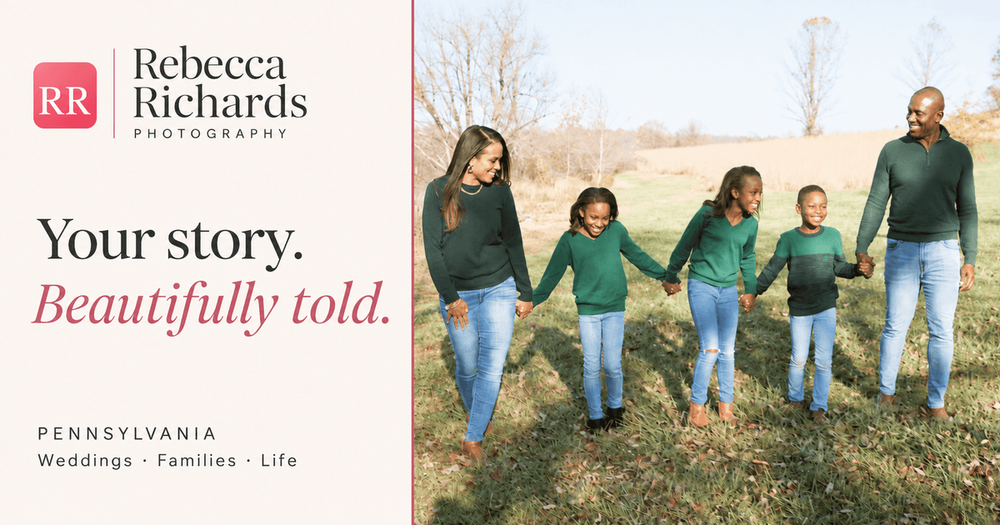

#  Rebecca Richards Photography



[](https://github.com/nicholasadamou/rebecca-richards-photography/actions/workflows/ci.yml)


[](LICENSE)

Rebecca Richards’s wedding and portrait photography portfolio. Sanity supplies
albums and images; Astro builds the pages, and React powers the galleries and
animations. The repository also includes a Sanity Studio and an album import
tool.

## Getting started

```sh
npm ci
npm run dev
```

## Documentation

- [Getting started](docs/getting-started.md): Node.js, local previews, and CMS configuration.
- [Local verification and development](docs/development.md): builds, scripts, screenshots, and project layout.
- [Open Graph images](docs/OG-IMAGES.md): social cards and image generation.
- [Search metadata](docs/SEO-IMPLEMENTATION.md): page metadata, structured data, and sitemaps.
- [Album scraper](client-album-scraper/README.md): the separate Python content-import tooling.

## Local verification

Use Node.js 24 and run `npm ci` followed by `npm run build`. GitHub Actions runs
the same build on Ubuntu for pushes and pull requests, including Open Graph
image generation, and retains the built site for seven days.

See [development](docs/development.md) for additional checks and CMS tooling.

## License

Copyright © 2025 Nicholas Adamou.

The project is licensed under [MIT License](LICENSE).

Photography belongs to Rebecca Richards Photography and is excluded from the MIT
license. See the [photography notice](LICENSE).
